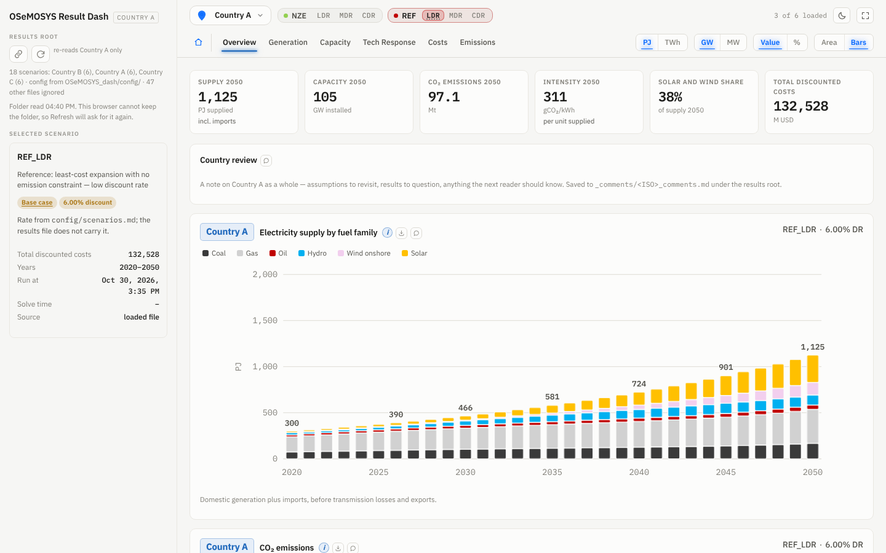
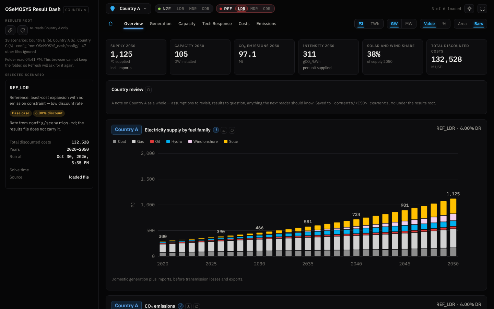

# OSeMOSYS Result Dash

A single-file dashboard for reading OSeMOSYS power-sector results across
countries, scenarios and discount rates. It runs in the browser from the
file itself: no server and no installation. Fonts load from Google Fonts
when online; offline the page falls back to system fonts.

The dashboard reads two kinds of file and nothing else:

1. the markdown files in `config/`, which say what the study contains;
2. the plain-text results files that `config/results.md` points to.

Everything specific to a study (countries, map coordinates, scenario codes,
discount rates, technology codes, colours, plant lives, committed pipeline)
lives in `config/`. The HTML file holds only the method.

Version 0.1.2. The results shipped in `results/` are synthetic placeholders
for three invented countries; they describe no real system.

## Quick start

1. Download or clone the repository.
2. Open `OSeMOSYS_dash.html` in Chrome or Edge.
3. When the opening animation ends, click **Connect your results folder**
   and choose the repository folder itself (the one holding `config/`).
4. Click a lit marker on the map to open a country.

After a new model run, copy the results file into `results/` and press
Refresh. Chrome and Edge remember the linked folder between sessions; other
browsers ask for it each time.

## Interface tour

`docs/TOUR.md` walks through the interface step by step, with screenshots
in the light and the dark theme: connecting the folder, the map and its
hover cards, the scenario table, every tab, the annualised capital charge,
and the reading aids and warnings.

| Light | Dark |
|---|---|
|  |  |

## Repository layout

```
OSeMOSYS_dash/
  OSeMOSYS_dash.html     the dashboard (open this)
  config/                what to read and how to label it  (read by the dash)
  results/               model results, one .txt per country and scenario  (read by the dash)
  data/                  your model inputs and sources  (never read by the dash)
  docs/                  interface tour (with screenshots), user guide, config reference, results format, methods
  tools/                 helper scripts (placeholder generator, code lister)
  tests/                 browser tests with known answers
  archive/               superseded files; never read
  AGENTS.md, SKILL.md    instructions for AI agents working on or with this tool
  CHANGELOG.md, DECISIONS.md, DEBT.md, LICENSE
```

## Which markdown does what

| File | Required | What it controls |
|---|---|---|
| `config/results.md` | yes | which `.txt` files are results, and where the country and scenario codes sit in each path |
| `config/countries.md` | yes | country codes, display names, map coordinates, hover-card profiles |
| `config/scenarios.md` | yes | scenario codes, the case and variant each belongs to, discount rates, the base case |
| `config/technologies.md` | yes | technology code to family mapping, family roles and colours, fuels, storage, the demand technology |
| `config/dashboard.md` | no | title, first cost year, capacity-to-activity unit, comments folder, export prefix |
| `config/investment.md` | no | plant lives and committed pipeline, for the annualised capital charge only |

Full column-by-column rules are in `docs/CONFIG_REFERENCE.md`.

## Results structure

A results file is the plain-text solution OSeMOSYS writes (one variable per
line, `index  Variable(args)  value  dual`, objective value on the first
line). The dashboard finds results by pattern. The shipped patterns are:

```
results/*_{scenario}_{iso3}.txt      e.g. results/results_REF_LDR_XAA.txt
results/{iso3}/{scenario}.txt        e.g. results/XAA/REF_LDR.txt
```

`{iso3}` matches only codes listed in `config/countries.md` and
`{scenario}` only codes listed in `config/scenarios.md`. Change or add
patterns in `config/results.md` to fit an existing folder layout instead of
renaming files. One file per country and scenario: a second match is
refused and named, never added to the first. Folders named `archive`,
`archived`, `old` or `superseded` are skipped. See `docs/RESULTS_FORMAT.md`.

## Using it for your own study

1. Replace the rows in `config/countries.md` with your countries.
2. List your scenario codes and their discount rates in `config/scenarios.md`.
3. Run `python tools/list_codes.py` on one results file; it lists every
   technology code in the file and flags those missing from
   `config/technologies.md`. Map each one to a family.
4. Put your results in `results/` (or edit `config/results.md` to match
   where they already are), delete the placeholder results, and press Refresh.
5. Open Home, More, Files read: any configuration warning is listed there.

## Tests

```
npm install            # Playwright, test-only dependency
npx playwright install chromium
node tests/known_answers.js
node tests/smoke.js
node tests/refresh.js
```

`known_answers.js` checks the capital recovery factor, the pattern
matcher, the markdown table reader, discount-rate precedence and one
annualised pipeline charge against hand-computed values. `smoke.js` loads
the repository through the folder input and opens every tab in both themes.
`refresh.js` drives Refresh with a stand-in for the linked folder.

## Limits

- Chrome or Edge is needed to keep the folder linked; Firefox and Safari
  read the folder but ask for it on each Refresh.
- Results files are parsed in the browser; very large files (hundreds of MB)
  are slow.
- The discount rate is not recorded in a results file; the dashboard can be
  no more correct than `config/scenarios.md`.
- Milestone year labels assume a 2020 to 2050 horizon (see `DEBT.md`).

## Licence

Apache License 2.0, see `LICENSE` and `NOTICE`. Copyright 2026 EL.
